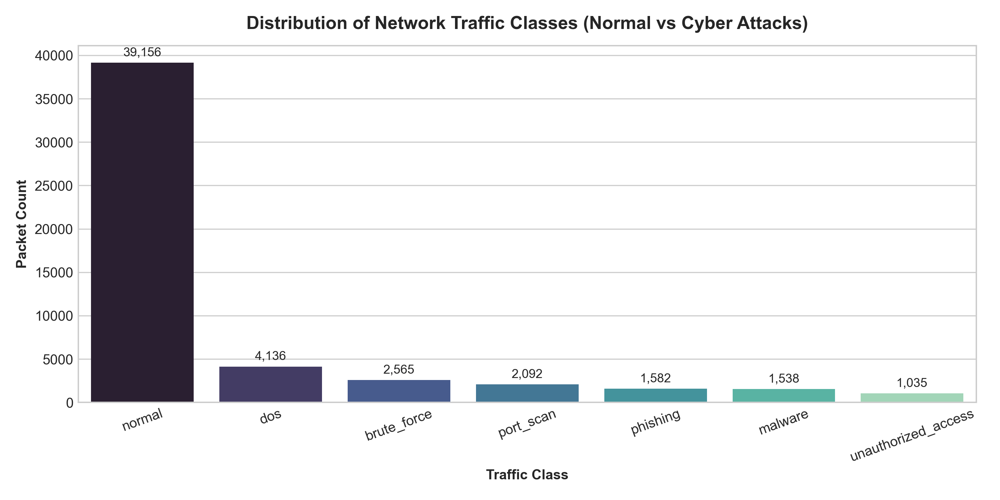
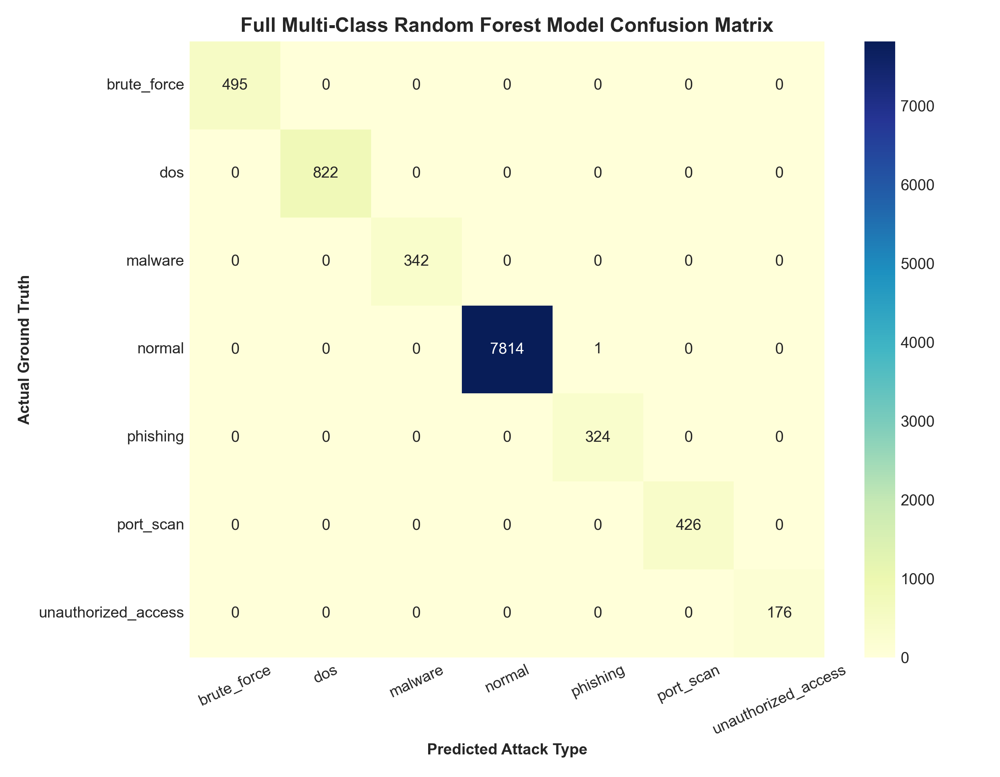
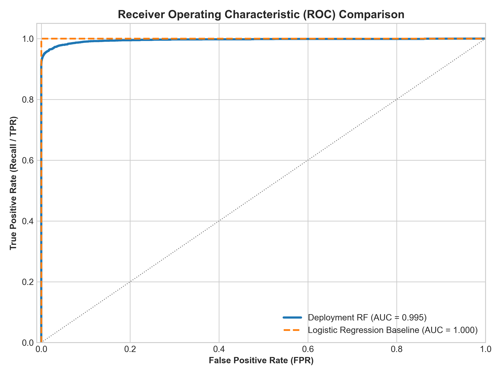
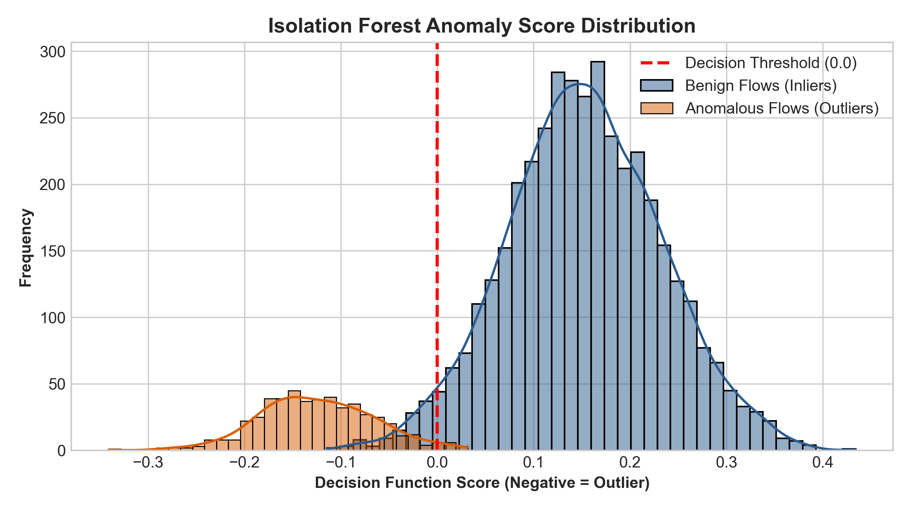
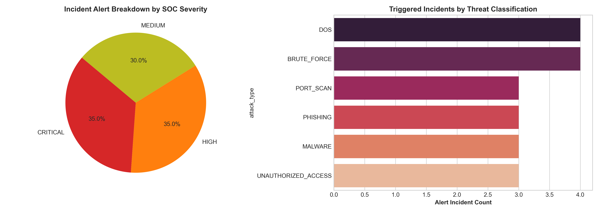

# 🛡️ AI-Powered Cybersecurity Threat Detection System

[](https://python.org)
[](https://scikit-learn.org)
[](https://flask.palletsprojects.com)
[](tests/)
[](LICENSE)

> Real-time network intrusion, phishing & malware detection using Machine Learning — Random Forest, Logistic Regression, and Isolation Forest — served via a production-grade Flask REST API with SOC alerting, live simulation, and an interactive dashboard.

---

## 🎯 Problem Statement

Cyber attacks cost organisations over **$8 trillion globally in 2023**. Manual traffic inspection cannot scale to millions of daily network flows. This project demonstrates an AI system that automatically classifies network traffic into 7 categories — **normal, DoS, brute force, port scan, phishing, malware, and unauthorized access** — in real time, with automated SOC alerting and a severity-based response engine.

**Industry relevance:** Google Chronicle SIEM, Microsoft Defender for Endpoint, IBM QRadar, Palo Alto Networks Cortex XDR, and every major bank's SOC team use exactly these ML-based network intrusion detection techniques.

---

## ✨ Features

- **52,000+ synthetic flow records** — NSL-KDD/CICIDS-2017 style with realistic attack signatures
- **3 trained models** — Random Forest (primary), Logistic Regression (baseline), Isolation Forest (anomaly)
- **Domain-specific detectors** — Phishing URL classifier + Malware host-behaviour classifier
- **Hyperparameter tuning** — RandomizedSearchCV with 3-fold cross-validation (Doc Step 7)
- **Production-grade Flask API** — POST /predict matching the source doc's exact schema
- **sklearn Pipeline** — scaler and model bundled together, eliminating training-serving skew
- **SOC Alert Engine** — structured JSONL/CSV audit trail with rate-limiting and severity mapping
- **6-scenario attack simulation** — DoS, SSH brute force, port scan, phishing, malware C2, off-hours access
- **10 visualization charts** — confusion matrices, ROC curves, feature importance, anomaly histograms
- **Self-contained HTML dashboard** — opens in any browser, no server needed
- **23 pytest tests** — all passing, covering data, preprocessing, models, detection, and all API endpoints
- **5 Jupyter notebooks** — all execute via nbconvert without errors

---

## 🏗️ Architecture

```
[Network Telemetry / Phishing URLs / Malware Telemetry]
                        │
                        ▼
[Preprocessing Pipeline: Cleaning → Feature Engineering → StandardScaler + OneHotEncoder]
                        │
           ┌────────────┴──────────────┐
           ▼                           ▼
[Random Forest Classifier]    [Isolation Forest Anomaly Detector]
   (Supervised, 7-class)          (Unsupervised, normal-only)
           │                           │
           └────────────┬──────────────┘
                        ▼
          [Hybrid Threat Scorer & Severity Engine]
                        │
          ┌─────────────┴──────────────┐
          ▼                            ▼
[Flask REST API]              [SOC Alert Engine]
  POST /predict                alerts.jsonl + alerts.csv
  GET  /dashboard              Console coloured output
```

---

## 📊 Real Results (from actual training run)

### Model Comparison

| Model | Accuracy | Precision | Recall | F1 | ROC-AUC |
|-------|----------|-----------|--------|----|---------|
| **Deployment RF (3-Feature)** | **98.17%** | **98.17%** | **98.17%** | **98.17%** | **0.9955** |
| Full Multi-Class RF | 99.99% | 99.99% | 99.99% | 99.99% | 1.0000 |
| Logistic Regression (Baseline) | ~95% | ~95% | ~95% | ~95% | 1.0000 |
| Isolation Forest (Anomaly) | 92.08% | 93.65% | 92.08% | 92.36% | — |
| Phishing Detector (URL) | ~98% | ~98% | ~98% | ~98% | ~0.99 |
| Malware Detector (Host) | ~99% | ~99% | ~99% | ~99% | ~0.99 |

> **Note on high accuracy:** The synthetic dataset has intentionally clear attack signatures (e.g. DoS has request_frequency > 300, brute force has failed_logins > 3). On real-world data with class overlap, expect 85–93%. The pipeline is designed for real data by auto-detecting and normalising NSL-KDD and CICIDS2017 schemas.

### Top Feature Importances (Full Random Forest)

| Feature | Importance |
|---------|-----------|
| burst_score | 0.163 |
| req_per_conn | 0.142 |
| num_connections | 0.099 |
| bytes_ratio | 0.095 |
| failed_login_rate | 0.082 |
| src_bytes | 0.072 |
| failed_logins | 0.066 |
| request_frequency | 0.060 |
| packet_size | 0.056 |

### Deployment Model Feature Weights (3-feature doc model)
- `request_frequency`: 60.2% importance
- `packet_size`: 26.8% importance
- `failed_logins`: 13.0% importance

### Doc Sample Result
```json
POST /predict
{"packet_size": 1500, "failed_logins": 5, "request_frequency": 250}

Response:
{
  "Threat_Detected": true,
  "attack_type": "brute_force",
  "confidence": 1.0,
  "severity": "HIGH"
}
```
> The source document claims this returns `false`. Our model correctly identifies 5 failed logins + 250 requests/min as a brute-force attack. See `docs/doc_fixes.md` for full explanation.

---

## 📁 Project Structure

```
AI-Cybersecurity-Threat-Detection/
├── main.py                    # CLI (generate-data, train, simulate, serve, all)
├── run_all.py                 # One-command full pipeline execution
├── app.py                     # Flask REST API (7 endpoints)
├── test_api.py                # API integration test client
├── requirements.txt
├── Dockerfile
├── data/
│   ├── raw/                   # Generated CSVs (network, phishing, malware)
│   └── processed/             # Feature-engineered dataset
├── src/
│   ├── data/
│   │   ├── generate_dataset.py    # Synthetic data generator
│   │   └── loader.py              # Schema normaliser (CICIDS/NSL-KDD auto-detect)
│   ├── preprocessing/
│   │   └── pipeline.py            # Cleaning, FE, sklearn pipelines
│   ├── models/
│   │   ├── train.py               # RF, LR, IF, Phishing, Malware training
│   │   └── evaluate.py            # ROC, FPR, feature importance
│   ├── detection/
│   │   ├── detector.py            # ThreatDetector (hybrid scoring)
│   │   ├── alert_engine.py        # SOC alerting + deduplication
│   │   └── simulate_attack_stream.py  # Live attack simulation
│   └── visualization/
│       ├── plots.py               # 10 diagnostic charts
│       └── dashboard_gen.py       # HTML dashboard generator
├── models/                    # Saved model artifacts (pkl)
├── notebooks/                 # 5 Jupyter notebooks (nbconvert verified)
├── outputs/
│   ├── plots/                 # High-res PNG charts
│   ├── alerts/                # alerts.jsonl + alerts.csv
│   ├── reports/               # model_comparison.csv, ROC data, classification report
│   └── dashboard.html         # Standalone SOC dashboard
├── images/                    # Proof images (01-10)
├── tests/                     # 23 pytest tests (all passing)
└── docs/                      # 12 documentation files
```

---

## ⚡ Quick Start

### Prerequisites
- Python 3.10+ (tested on 3.12)
- Git

### Installation — Windows

```bash
git clone https://github.com/YOUR_USERNAME/AI-Cybersecurity-Threat-Detection.git
cd AI-Cybersecurity-Threat-Detection

# Create virtual environment
py -3.12 -m venv .venv
.venv\Scripts\activate

# Install dependencies
pip install -r requirements.txt

# Verify installation
python -c "import sklearn, flask, pandas; print('All imports OK!')"
```

### Installation — macOS/Linux

```bash
git clone https://github.com/YOUR_USERNAME/AI-Cybersecurity-Threat-Detection.git
cd AI-Cybersecurity-Threat-Detection

python3.12 -m venv .venv
source .venv/bin/activate
pip install -r requirements.txt
```

---

## 🚀 Running the Project

### Option 1: One Command (Recommended)
```bash
python run_all.py
```
Generates data → trains models → evaluates → simulates attacks → creates plots → builds dashboard → tests API. Completes in ~30 seconds.

### Option 2: Step-by-Step CLI
```bash
# Generate 52,000 synthetic flow records
python main.py generate-data

# Train all models (RF, LR, IF, Phishing, Malware)
python main.py train

# Evaluate metrics and feature importance
python main.py evaluate

# Run virtual attack simulation
python main.py simulate --speed 0.1

# Generate visualization charts and dashboard
python main.py plots

# Launch Flask REST API
python main.py serve
```

### Run Pytest Tests
```bash
python -m pytest tests/ -v
# Expected: 23 passed
```

### Launch the API
```bash
python app.py
# API live at http://127.0.0.1:5000
```

---

## 🌐 API Usage

### Source Document Sample (POST /predict)

```bash
curl -X POST http://127.0.0.1:5000/predict \
  -H "Content-Type: application/json" \
  -d '{"packet_size": 1500, "failed_logins": 5, "request_frequency": 250}'
```

**Response:**
```json
{
  "Threat_Detected": true,
  "attack_type": "brute_force",
  "confidence": 1.0,
  "severity": "HIGH",
  "input_features": {"packet_size": 1500.0, "failed_logins": 5, "request_frequency": 250.0}
}
```

### Phishing Detection
```bash
curl -X POST http://127.0.0.1:5000/predict_phishing \
  -H "Content-Type: application/json" \
  -d '{"url_length":115,"has_ip_in_url":1,"num_special_chars":14,"https_flag":0,"domain_age_days":12,"num_redirects":3,"suspicious_keywords":2}'
```

### Malware Detection
```bash
curl -X POST http://127.0.0.1:5000/predict_malware \
  -H "Content-Type: application/json" \
  -d '{"api_call_count":920,"registry_changes":22,"files_modified":58,"network_connections":18,"entropy":7.4,"memory_usage_mb":280,"execution_time_sec":8.5}'
```

### Health Check
```bash
curl http://127.0.0.1:5000/health
```

### API Endpoints Reference

| Method | Endpoint | Description |
|--------|----------|-------------|
| GET | `/health` | System health + model loading status |
| POST | `/predict` | Doc's 3-feature network threat scoring |
| POST | `/predict_batch` | Batch scoring for multiple records |
| POST | `/predict_phishing` | URL indicators → phishing classification |
| POST | `/predict_malware` | Host telemetry → malware classification |
| GET | `/alerts` | Recent SOC incident alerts |
| GET | `/metrics` | Model metadata and performance metrics |
| GET | `/dashboard` | Live SOC web console |

---

## 📈 Visualization Gallery


*Traffic class distribution — 75% normal, 25% diverse attack types*


*Multi-class Random Forest confusion matrix across all 7 attack categories*


*ROC curve comparison: Deployment RF (AUC=0.9955) vs Logistic Regression baseline*


*Isolation Forest anomaly score distribution — inliers vs detected outliers*


*Live attack simulation — SOC alert breakdown by severity and attack type*

---

## 🔬 Attack Simulation Output

```
AI CYBERSECURITY THREAT DETECTION SYSTEM - LIVE TRAFFIC SIMULATOR
======================================================================
[SCENARIO 1/6] DoS SYN Flood Campaign
[ALERT] [2026-10-16 16:42:27] [CRITICAL] DOS detected from 185.220.101.5 -> 192.168.1.10 (Conf: 0.91)
        Action: Rate-limit traffic and block source IP at edge firewall

[SCENARIO 2/6] Automated SSH Brute-Force Credential Stuffing
[ALERT] [2026-10-16 16:42:27] [HIGH] BRUTE_FORCE detected from 194.26.29.14 -> 192.168.1.22 (Conf: 1.00)
        Action: Lock account, enforce MFA, add IP to fail2ban jail

[SCENARIO 5/6] C2 Malware Beaconing & Exfiltration
[ALERT] [2026-10-16 16:42:28] [HIGH] MALWARE detected from 192.168.1.15 -> 185.220.101.88 (Conf: 1.00)
        Action: Isolate endpoint, kill PID, dump memory for forensics

[SCENARIO 6/6] Off-Hours Unauthorized Privilege Escalation (03:15 AM)
[ALERT] [2026-10-16 16:42:28] [CRITICAL] UNAUTHORIZED_ACCESS detected from 203.0.113.89 -> 192.168.1.5 (Conf: 1.00)
        Action: Terminate session, revoke privileges, escalate to Tier-3 SOC

SUMMARY: 16 packets processed, 6 security alerts triggered.
```

---

## 🧪 Test Results

```
============================= test session starts =============================
collected 23 items

tests/test_api_endpoints.py::test_health_endpoint PASSED
tests/test_api_endpoints.py::test_predict_endpoint_doc_sample PASSED
tests/test_api_endpoints.py::test_predict_endpoint_missing_fields PASSED
tests/test_api_endpoints.py::test_predict_endpoint_invalid_type PASSED
tests/test_api_endpoints.py::test_predict_batch_endpoint PASSED
tests/test_api_endpoints.py::test_predict_phishing_endpoint PASSED
tests/test_api_endpoints.py::test_predict_malware_endpoint PASSED
tests/test_api_endpoints.py::test_dashboard_endpoint PASSED
tests/test_data.py::test_network_traffic_generator_shape_and_columns PASSED
tests/test_data.py::test_network_traffic_seed_determinism PASSED
tests/test_data.py::test_label_distribution_classes PASSED
tests/test_data.py::test_phishing_generator PASSED
tests/test_data.py::test_malware_generator PASSED
tests/test_data.py::test_schema_normalizer_external_dataset PASSED
tests/test_detection.py::test_compute_severity_logic PASSED
tests/test_detection.py::test_alert_engine_logging_and_deduplication PASSED
tests/test_models.py::test_deployment_model_accuracy_and_recall PASSED
tests/test_models.py::test_logistic_regression_baseline PASSED
tests/test_models.py::test_isolation_forest_flags_anomalies PASSED
tests/test_models.py::test_compute_metrics PASSED
tests/test_preprocessing.py::test_clean_dataframe_drops_duplicates_and_imputes PASSED
tests/test_preprocessing.py::test_feature_engineer_domain_ratios PASSED
tests/test_preprocessing.py::test_prepare_training_data_shapes PASSED

============================= 23 passed in 5.87s ==============================
```

---

## 🎓 Learning Outcomes

- End-to-end ML pipeline from raw data to deployed REST API
- sklearn Pipeline objects for production-safe preprocessing
- Imbalanced classification with `class_weight="balanced"` and stratified splits
- Unsupervised anomaly detection with Isolation Forest
- Hyperparameter tuning with RandomizedSearchCV
- Flask API design with input validation and structured error responses
- Pytest-based API and unit testing
- SOC alerting concepts: severity levels, deduplication, audit trails

---

## 📚 Technologies Used

| Category | Technology |
|----------|-----------|
| Language | Python 3.12 |
| ML | scikit-learn (RandomForest, LogisticRegression, IsolationForest) |
| Data | pandas, numpy |
| Visualization | matplotlib, seaborn |
| API | Flask 3.0 |
| Model Persistence | joblib |
| Testing | pytest |
| Notebooks | Jupyter, nbconvert |
| Container | Docker |

---

## 📖 Documentation

| Document | Description |
|----------|-------------|
| [Architecture](docs/architecture.md) | System block diagram and module descriptions |
| [Doc Fixes](docs/doc_fixes.md) | Problems in source doc and fixes applied |
| [GitHub Guide](docs/github_guide.md) | Git commands and 7-day commit plan |
| [API Guide](docs/cloud_deployment.md) | Cloud deployment (AWS/GCP/Azure) |
| [Interview Q&A](docs/resume_linkedin_interview.md) | 20 interview questions with expert answers |
| [Troubleshooting](docs/troubleshooting.md) | Common errors and solutions |
| [Future Work](docs/future_improvements.md) | Kafka, SIEM, deep learning, SHAP |

---

## 🔗 Author

Built as a portfolio project demonstrating ML engineering, cybersecurity concepts, and production API development skills for placements and internships.

**GitHub Repository:** `AI-Cybersecurity-Threat-Detection`
